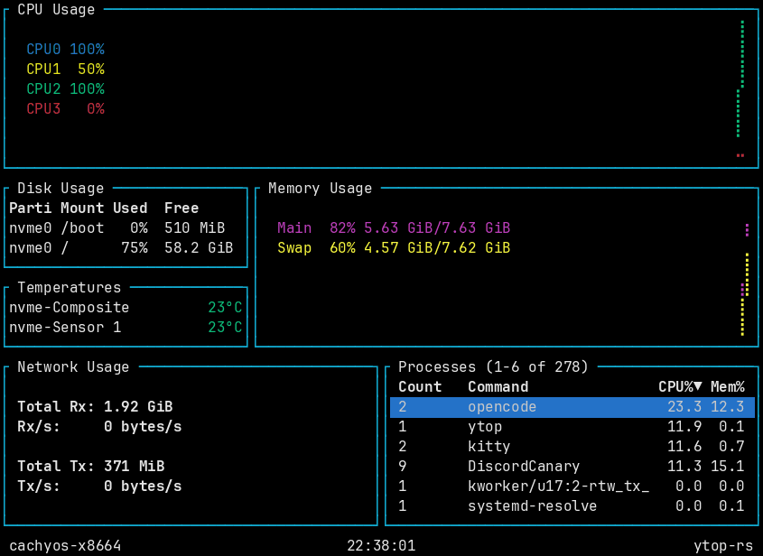
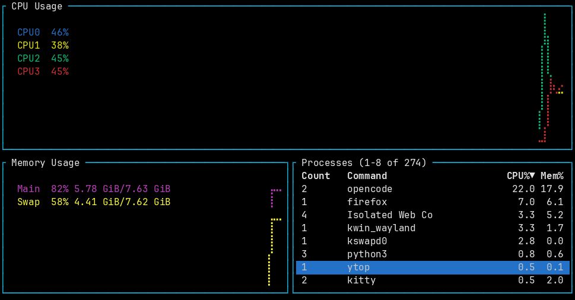

# ytop

<div align="center">

*Another* TUI based system monitor, this time in Rust!




</div>

> This repository is a maintained fork of
> [cjbassi/ytop](https://github.com/cjbassi/ytop), which has not been
> maintained since 2020. All credit for the original project goes to
> [Caleb Bassi (@cjbassi)](https://github.com/cjbassi).

## What's new in this fork

- **Process filtering**: press `/` to filter processes by name or command line
- **Mouse support**: click to select a process and use the mouse wheel to
  scroll through the process list; run with `-M`/`--no-mouse` to disable mouse
  capture
- **macOS process command lines**: read via `KERN_PROCARGS2`, since psutil does
  not implement them on macOS
- Builds on current stable Rust again (dependency and toolchain refresh)

## Missing features

- macOS is missing disk io counters
- FreeBSD is currently unsupported, because
  [psutil](https://github.com/giletka/psutil-rs) only supports Linux and macOS

## Installation

ytop runs on Linux and macOS.

### From source

```bash
cargo install --git https://github.com/hakuxyz/ytop
```

### Prebuilt binaries

Prebuilt binaries are provided in the [releases](https://github.com/hakuxyz/ytop/releases) tab.

### Packages of the original project

[](https://repology.org/project/ytop/versions)

The AUR (`ytop`, `ytop-bin`, `ytop-git`), the
[COPR](https://copr.fedorainfracloud.org/coprs/atim/ytop/) package and the
Homebrew tap all track the original unmaintained upstream.

## Usage

### Keybinds

- Quit: `q` or `<C-c>`
- Pause: `<Space>`
- Process navigation:
	- `k` and `<Up>`: up
	- `j` and `<Down>`: down
	- `<C-u>`: half page up
	- `<C-d>`: half page down
	- `<C-b>`: full page up
	- `<C-f>`: full page down
	- `gg` and `<Home>`: jump to top
	- `G` and `<End>`: jump to bottom
- Process actions:
	- `<Tab>`: toggle process grouping
	- `dd`: kill selected process or process group
- Process sorting:
	- `p`: PID/Count
	- `n`: Command
	- `c`: CPU
	- `m`: Mem
- Process filtering:
	- `/`: start editing filter
	- (while editing):
		- `<Enter>`: accept filter
		- `<C-c>` and `<Escape>`: clear the filter and stop editing
	- `<Escape>`: clear an already accepted filter
- CPU and Mem graph scaling:
	- `h`: scale in
	- `l`: scale out
- `?`: toggles keybind help menu

### Mouse

- click to select a process
- mouse wheel to scroll through processes

Mouse capture is enabled by default and can be turned off with the
`-M`/`--no-mouse` flag.

### Colorschemes

ytop ships with a few colorschemes which can be set with the `-c` flag followed by the name of one. You can find all the colorschemes in the [colorschemes folder](./colorschemes).

To make a custom colorscheme, copy one of the default ones to `~/.config/ytop/<new-name>.json` and load it with `ytop -c <new-name>`. Colorscheme PRs are welcome!

### CLI Options

```
ytop 0.7.0

USAGE:
    ytop [FLAGS] [OPTIONS]

FLAGS:
    -a, --average-cpu
            Show average CPU in the CPU widget

    -b, --battery
            Show Battery widget (overridden by 'minimal' flag)

    -f, --fahrenheit
            Show temperatures in fahrenheit

    -h, --help
            Prints help information

    -m, --minimal
            Only show the CPU, Mem, and Process widgets

    -M, --no-mouse
            Disable mouse capture

    -p, --per-cpu
            Show each CPU in the CPU widget

    -s, --statusbar
            Show a statusbar with the time

    -V, --version
            Prints version information


OPTIONS:
    -c, --colorscheme <colorscheme>
            Colorschemes:
                - default
                - default-dark (for white backgrounds)
                - solarized-dark
                - monokai
                - vice
             [default: default]
    -i, --interface <interface>
            The name of the network interface to show in the Net widget. 'all' shows all interfaces [default: all]

    -I, --interval <interval>
            Interval in seconds between updates of the CPU and Mem widgets. Can specify either a whole number or a
            fraction with a numerator of 1 [default: 1]
```

## Credits

ytop was created by [Caleb Bassi](https://github.com/cjbassi). This fork
continues the original project at
https://github.com/hakuxyz/ytop — please credit the original repository and its
author when redistributing.

## Related projects

- [bashtop](https://github.com/aristocratos/bashtop)
- [bottom](https://github.com/ClementTsang/bottom)
- [glances](https://github.com/nicolargo/glances)
- [gotop](https://github.com/cjbassi/gotop)
- [gtop](https://github.com/aksakalli/gtop)
- [htop](https://github.com/hishamhm/htop)
- [vtop](https://github.com/MrRio/vtop)
- [zenith](https://github.com/bvaisvil/zenith)
